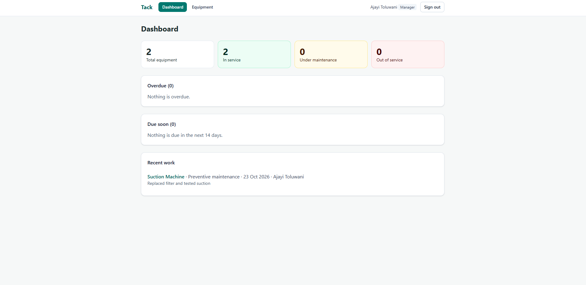
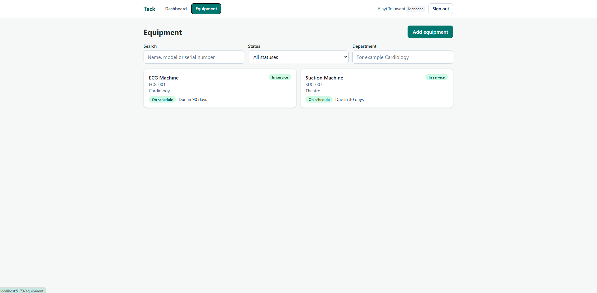
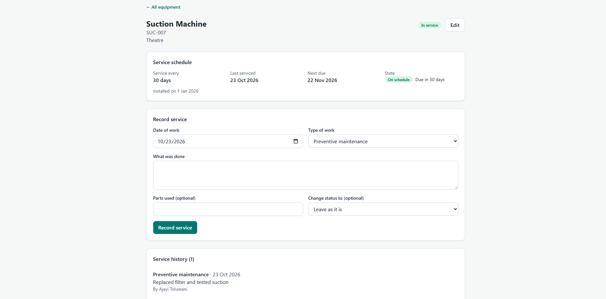

# Tack

Tack is a maintenance tracker for hospital medical equipment. It records what each machine is, where it is, when it was last serviced and when it is next due, so overdue work is easy to see.

**Live demo:** https://tack-app-six.vercel.app

Sign in with the demo manager (can add and edit equipment) or the demo technician (can view equipment and record service):

| Role | Email | Password |
| --- | --- | --- |
| Manager | `manager@tack-demo.dev` | `TackDemo2026!` |
| Technician | `technician@tack-demo.dev` | `TackDemo2026!` |

It is a public demo with made-up data, so other visitors may have changed what you see.

## Screenshots

| Dashboard | Equipment list | Equipment details |
| --- | --- | --- |
|  |  |  |

## What it does

- **Sign in** with two roles. The first account on a new system becomes the manager; everyone after is a technician.
- **Dashboard** with counts by status, overdue and due-soon equipment, and recent work.
- **Equipment list** with search and filters by status and department. The filters live in the address, so a refresh keeps them.
- **Service schedule.** Give an item a service interval (for example every 90 days) and Tack works out the next due date and marks it on schedule, due soon (within 14 days) or overdue.
- **Service records.** Technicians and managers record preventive work, repairs, inspections and calibrations with the date, a description and any parts used. Preventive work and calibrations restart the schedule; repairs and inspections do not. A record can also change the equipment's status in the same step.
- **Roles.** Managers add and edit equipment. Technicians can view equipment and record service, and do not see add or edit buttons.
- **Phone friendly.**

All data used while building is made up. Do not enter real patient information.

## Stack

- Frontend: React 19, Vite, Tailwind CSS, React Router
- Backend: Node.js, Express 5, TypeScript, Zod, PostgreSQL
- Tests: `node:test` with a real in-memory Postgres (PGlite) for the API, and Playwright with a mocked API for the screens

## API

| Method and path | Who | What |
| --- | --- | --- |
| `POST /api/auth/register`, `POST /api/auth/login`, `GET /api/auth/me` | anyone / signed in | Accounts |
| `GET /api/equipment?status=&department=&q=` | signed in | List with schedule status |
| `GET /api/equipment/:id` | signed in | One item |
| `POST /api/equipment`, `PATCH /api/equipment/:id` | manager | Add and edit |
| `GET /api/equipment/:id/maintenance` | signed in | Service history, newest first |
| `POST /api/equipment/:id/maintenance` | signed in | Record service work |
| `GET /api/dashboard` | signed in | Totals, overdue, due soon, recent work |

## Run it

You need Node.js and a PostgreSQL database (a free Neon project works).

```bash
# backend
cd backend
npm install
cp .env.example .env.local   # add DATABASE_URL and JWT_SECRET
npm run migrate
npm run seed                 # optional: demo accounts and sample equipment
npm run dev                  # http://localhost:5000

# web app (new terminal)
cd frontend
npm install
cp .env.example .env.local   # VITE_API_URL points at the backend
npm run dev                  # http://localhost:5173
```

## Tests

```bash
cd backend && npm test                 # API tests
cd frontend && npm test                # unit tests
cd frontend && npx playwright install chromium   # first time only
cd frontend && npm run test:browser    # browser tests
```

## Deployment

The web app and the API are two Vercel projects, and the database is Postgres on Neon.

- The API runs as one serverless function. `npm run build:vercel` in `backend` bundles the Express app into the Vercel Build Output format, and the build also runs the migrations. Run `npm run seed` once by hand to load the demo data.
- The API needs `DATABASE_URL`, `JWT_SECRET`, `FRONTEND_URL` (the exact address of the web app, for CORS) and `TIMEZONE`.
- The web app is built with `VITE_API_URL` pointing at the API.
- After a deploy, run `npm run smoke -- https://your-api-url` in `backend`. It checks that the database is reachable, the demo login works and a wrong password gets a 401 instead of a server error.

## Known limitations

These are deliberate choices for a demo with no real patient or hospital data. A production version would change them.

- The sign-in token is kept in the browser's local storage. A production version would use an httpOnly cookie, which needs CSRF protection when the web app and the API are on different domains.
- Sign-in rate limiting counts attempts in memory, so on serverless each running instance keeps its own count. It slows down password guessing but is not a global limit.
- Service records can be added but not edited or deleted, and equipment cannot be deleted, only retired. Equipment edits are not yet written to a history table.
- Two managers editing the same item at the same time can overwrite each other. There is no version check yet.
- Equipment with a service interval but no install date counts its schedule from the day it was added.
